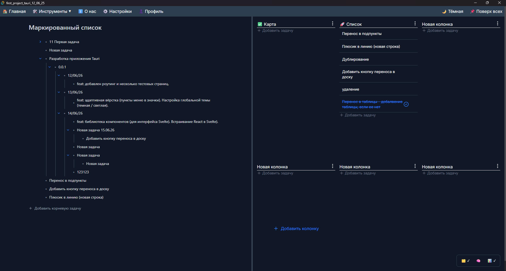
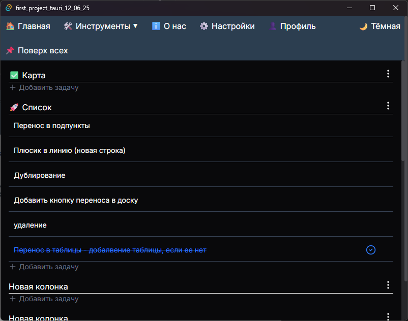
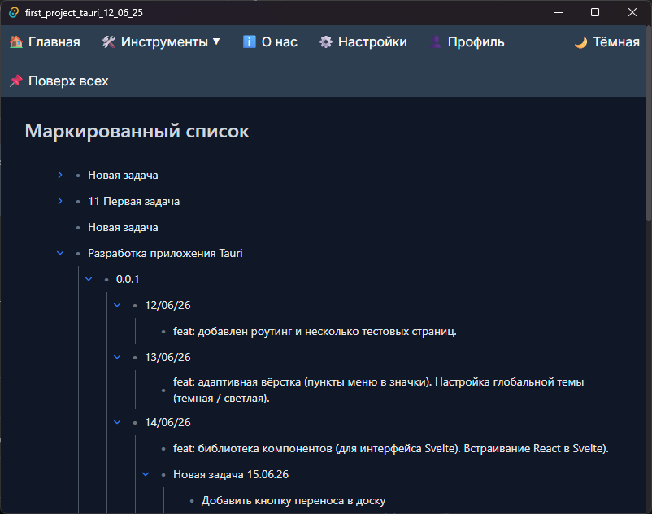
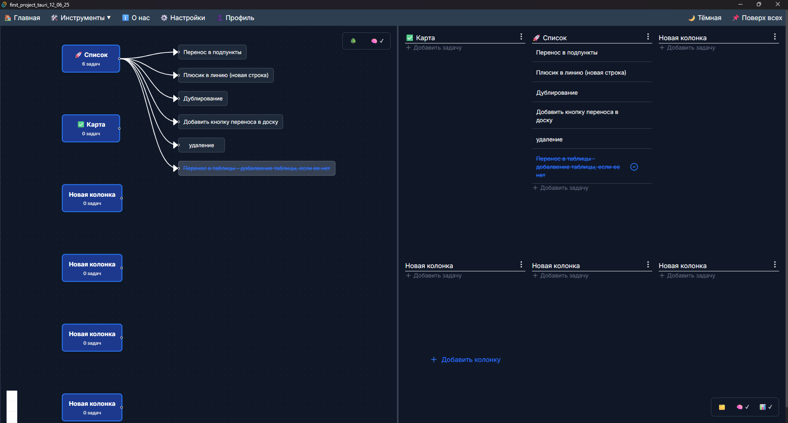
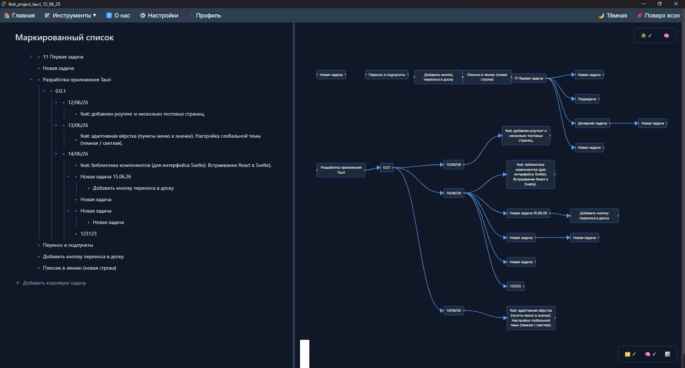

# Tauri Kanban + Outliner + Mind Map

**Desktop-приложение для управления задачами, заметками и визуализации связей.**

Личный инструмент, который я разрабатываю в одиночку. Совмещает три режима работы с задачами: **Kanban-доска**, **Outliner** (дерево задач) и **Mind Map** (визуализация связей в виде графа). Всё синхронизировано между собой.

> ⚠️ **Статус: v0.0.1 — активная разработка.**  
> Код не публикуется — проект рассматривается как основа для коммерческого продукта. Скриншоты и описание архитектуры доступны в этом репозитории. Известные глюки и планы — в разделе [Issues](https://github.com/Sovinka20/tauri-productivity-app/issues).

---

## ✨ Возможности

- **Kanban-доска** — колонки, карточки, drag-and-drop между колонками (`@dnd-kit`).
- **Outliner** — древовидный список задач с неограниченной вложенностью, сворачиванием/разворачиванием, переносом подпунктов.
- **Mind Map** — автоматическая визуализация связей задач в виде графа (`React Flow` + `ELK`).
- **Синхронизация** — задачи из Kanban можно экспортировать в Outliner, а Outliner и Kanban отображаются в Mind Map.
- **Переключение источника Mind Map** — верхняя правая часть полотна позволяет выбрать, что визуализировать: данные из **Kanban** или из **Outliner**.
- **Настройка отображения блоков** — нижний правый угол приложения позволяет включать/выключать отображение любого из блоков (Kanban, Outliner, Mind Map) по отдельности.
- **Drag-and-drop** с индикаторами вставки (как сиблинг или как ребёнок).
- **Тёмная и светлая темы** с плавным переключением.
- **Мультиязычность** (RU/EN).
- **Персистентность** — все данные сохраняются в `localStorage`.
- **Desktop-приложение** на Tauri (Rust + WebView).

---

## 🖼 Скриншоты

### Общий вид (Kanban + Outliner)
  
*Основной режим: Kanban с колонками и Outliner с деревом задач*

### Kanban-доска
  
*Колонки, карточки задач, drag-and-drop*

### Outliner
  
*Древовидная структура с датами, задачами и подзадачами*

### Mind Map — Kanban
  
*Визуализация Kanban в виде графа связей*

### Mind Map — Outliner
  
*Визуализация Outliner в виде графа связей*

---

## 🏗 Архитектура

Проект построен на **гибридной архитектуре Svelte + React** — это был первый эксперимент такого рода.

**Внутри:**
- **Svelte-сторы** (`outlinerStore`, `tweekStore`, `themeStore`) — управление состоянием с `localStorage`-персистентностью.
- **Svelte-компоненты** — обёртки для UI-примитивов.

**Снаружи:**
- **React-компоненты** — Kanban-доска, Outliner, Mind Map, карточки задач, drag-and-drop.
- **`@dnd-kit`** — drag-and-drop для Kanban и Outliner.
- **`@xyflow/react`** + **ELK** — визуализация графа с автоматической раскладкой.

### Почему так

- **Svelte** — для реактивного состояния с минимальным boilerplate. Сторы работают из коробки, персистентность — одна строка.
- **React** — для сложных интерактивных компонентов (drag-and-drop, граф). Экосистема `@dnd-kit` и `React Flow` на порядок богаче.
- **Совместно** — получаем лучшее из двух миров: лёгкое состояние + мощные UI-библиотеки.

---

## 🛠 Стек

**Frontend:**
- Svelte / SvelteKit
- React 18
- TypeScript
- Tailwind CSS

**Библиотеки:**
- `@dnd-kit/core`, `@dnd-kit/sortable` — drag-and-drop
- `@xyflow/react` — граф
- `elkjs` — автоматическая раскладка графа
- `lucide-react` — иконки

**Backend / Desktop:**
- Tauri 2
- Rust

**Инфраструктура:**
- Vite
- Git

---

## 🧠 Что было самым сложным

**1. Гибридная архитектура Svelte + React.**  
Нужно было понять, как Svelte-сторы подписываются на изменения из React-компонентов и наоборот. Это нестандартный подход, документации почти нет — разбиралась сама.

**2. Логика перемещения в Outliner.**  
При переносе задачи нужно пересчитать `order` для старых и новых сиблингов, обработать случай «вставить как ребёнка» и «вставить как сиблинга». Плюс индикаторы — визуальная линия должна совпадать с точкой вставки.

**3. Автоматическая раскладка графа.**  
`React Flow` даёт координаты вручную, но для дерева задач нужна автоматика. Использовала `ELK` с алгоритмом `layered` и направлением `RIGHT`.

**4. Связь между тремя режимами.**  
Kanban, Outliner и Mind Map — это не три отдельных приложения, а **одно целое**. Задачи, созданные в Kanban, попадают в Outliner и отображаются в Mind Map.

**5. Гибкое управление отображением.**  
Нужно было дать пользователю возможность самому решать, какие блоки показывать, и при этом не ломать layout. Плюс — переключение источника данных для Mind Map: граф может строиться как из Kanban, так и из Outliner.

---

## 📋 Использование

1. Запустите приложение.
2. **Kanban** — перетаскивайте карточки между колонками, добавляйте задачи через `+`.
3. **Outliner** — двойной клик по задаче для редактирования, `Enter` для сохранения, стрелки для сворачивания поддеревьев.
4. **Mind Map** — откройте вкладку «Карта», чтобы увидеть граф связей.
5. **Источник графа** — в верхней правой части полотна Mind Map переключайте между Kanban и Outliner, чтобы выбрать, какие данные визуализировать.
6. **Отображение блоков** — в нижнем правом углу приложения включайте/выключайте любой из блоков (Kanban, Outliner, Mind Map).
7. **Тема** — переключается в шапке (День / Ночь).
8. **Язык** — переключается глобусом (RU / EN).

---

## 🛠 Требования

- **ОС:** Windows / macOS / Linux (сборка под Windows протестирована).
- **Rust** и **Node.js** — для сборки из исходников.
- **Tauri CLI** — `cargo install tauri-cli`.

---

## 🚧 Известные ограничения

- Код не публикуется — проект рассматривается как основа для коммерческого продукта.
- Возможны глюки в анимациях и раскладке графа при больших объёмах данных.
- Мобильная версия не поддерживается (Desktop only).
- Полный список — в [Issues](https://github.com/Sovinka20/tauri-productivity-app/issues).

---

## 🗺 Планы

- [ ] Покрытие тестами (Vitest + Testing Library).
- [ ] Оптимизация раскладки графа для больших деревьев.
- [ ] Импорт/экспорт данных (JSON, Markdown).
- [ ] Кастомный тайтлбар (убрать нативную рамку Tauri).
- [ ] Календарь и таймер Pomodoro.
- [ ] Синхронизация между устройствами.

---

## 👨‍💻 Автор

**Sovinka20 (Ekaterina German)**  
GitHub: [@Sovinka20](https://github.com/Sovinka20)  
Email: 2015gev@gmail.com  
Telegram: [@Sovires](https://t.me/Sovires)

---

## 📄 Лицензия

Проект не лицензирован. Код является интеллектуальной собственностью автора.  
Скриншоты и описание архитектуры доступны для ознакомления.

---

## 🙏 Благодарности

- Иконки — [Lucide](https://lucide.dev).
- Автоматическая раскладка графа — [ELK](https://github.com/kieler/elkjs).
- Визуализация — [React Flow](https://reactflow.dev).
- Drag-and-drop — [dnd-kit](https://dndkit.com).

---

## 🐛 Обратная связь

Нашли баг или есть идея? Создавайте [issue](https://github.com/Sovinka20/tauri-productivity-app/issues).

---